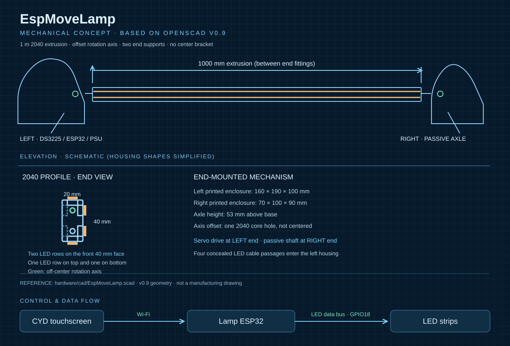
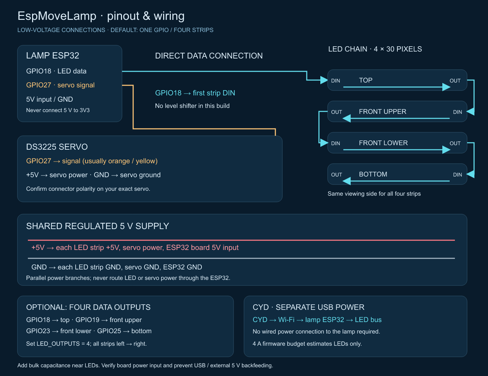

# EspMoveLamp

**A motorized, community-shared LED light bar for work, focus, and ambient lighting.**

EspMoveLamp is a DIY desktop light built around a 1-meter 2040 aluminum extrusion, four individually addressable WS2812 LED strips (120 LEDs total), an ESP32-controlled servo, and a separate ESP32 touchscreen controller (CYD). It offers directional lighting, customizable scenes, animated effects, and a local web editor — no cloud required.

> **Project status:** Work in progress. The electronics, touchscreen, and web editor have been developed and tested in stages; the 3D-printed mechanism and full system still require physical assembly and validation. This is not a certified consumer product.



## The story: from a simple light to EspMoveLamp

The project started with a very ordinary problem: my face was poorly lit during video calls in my home office. I looked for an affordable ready-made Zigbee light, but couldn't find one that suited my setup for less than roughly €120.

My first idea was simply to attach LED strips to a triangular wooden profile. Then I considered a spare aluminum extrusion and a pair of 3D-printed angle brackets. But what would be the *right* angle to light my face without glare while also illuminating the wall and ceiling?

An adjustable slot in the brackets would have solved that. Instead, I had a servo on hand — and one idea led to another.

The result is a motorized light bar that can tilt between direct meeting light, gentle morning illumination, indirect wall and ceiling lighting, warm evening scenes, and animated color effects. Its off-center rotation axis makes the light visibly fold up into position and return to a parked position when switched off. The 2040 extrusion is reused material from an earlier DIY laser build.

EspMoveLamp is still a personal maker project, built to solve a real problem and explore what is possible with parts already on hand.

## Highlights

- **120 individually addressable LEDs** across four 1-meter strips: top, front upper, front lower, and bottom
- **Three lighting directions:** top, front (two rows), and bottom; custom scenes currently set one color per direction
- **Motorized tilt** using a DS3225 servo, with scene-dependent target positions and animated movement
- **Park-on-off behavior:** the light switches off, moves toward a configured reference angle, then disables servo PWM
- **Independent CYD touchscreen** with four customizable scene favorites
- **Local browser-based scene editor** hosted by the CYD, with no internet account or cloud dependency
- **4–32 saved scenes**, icon and tile color selection, brightness, servo settings, JSON import/export
- **Built-in animated effects** including rainbow, ocean, candle, and other lighting styles
- **Wi-Fi communication** with discovery, acknowledgements, retry handling, and access-point fallback
- **Estimated LED current limiting**, configurable mechanical angle limits, and host-side tests

The hardware allows individual pixel control, but the current editor does **not yet** provide arbitrary per-pixel or left-to-right gradient editing for custom scenes.

## Gallery

Photos of the assembled light, its moving mechanism, and the finished desk setup will be added after the prototype is complete.


## Hardware overview

| Component | Purpose |
| --- | --- |
| 1 m black anodized 2040 aluminum extrusion | Light body and structural frame |
| 4 × 30-pixel WS2812 strips | Addressable lighting in four extrusion slots |
| ESP32-WROOM DevKit | LED effects, servo control, and wireless receiver |
| DS3225 servo | Motorized rotation |
| CYD ESP32 touchscreen (240 × 320) | Scene selection, manual control, and web editor |
| 5 V / 10 A supply (planned) | Lamp controller, LED strips, and servo |
| 3D-printed left and right mounts | Mechanical support and electronics enclosure |

The CYD uses its own separate enclosure and power supply. The planned left base houses the lamp ESP32, servo, and power supply; the right base supports the passive axle.

**Important:** The mains-powered enclosure is a prototype. A safe implementation requires suitable earthing where applicable, strain relief, insulation, accessible-terminal protection, ventilation, and verification by a qualified person. The printed cover alone is not evidence of electrical safety.

## LED wiring



[Vector diagram](hardware/docs/wiring.svg). This diagram documents the actual direct connection: ESP32 GPIO18 connects to DIN of the first LED strip, without a level shifter.

The current firmware uses **one data output on GPIO18** for a 120-pixel chain:

```text
GPIO18 -> TOP DIN -> FRONT UPPER -> FRONT LOWER -> BOTTOM
GPIO27 -> DS3225 signal
5 V supply -> parallel power injection to all four strips
GND -> common ground for LEDs, ESP32, and servo
```

Viewed from the same side, the data directions alternate:

| Strip | Data direction |
| --- | --- |
| Top | Left to right |
| Front upper | Right to left |
| Front lower | Left to right |
| Bottom | Right to left |

The firmware reverses the logical pixel order of the second and fourth strips so effects have a consistent left-to-right direction. Four independent data outputs are an optional, currently disabled configuration using GPIO18, GPIO19, GPIO23, and GPIO25.

Power the LEDs and servo from an adequately rated supply, **not through the ESP32 USB connector**. Classic WS2812 LEDs can draw up to approximately 7.2 A at full RGB white across 120 pixels. Firmware currently caps *estimated LED current* to 4 A; this is not a measured total-system current limit. The DS3225 also needs sufficient transient current. Use appropriate wiring, protection, and power injection. The ESP32 and LED supply must share a common ground.

## Mechanical design and 3D printing

The current **v0.9 prototype** lives in [`hardware/`](hardware/docs/assembly.md):

- [OpenSCAD source](hardware/cad/EspMoveLamp.scad)
- [STL files](hardware/stl/)
- [Assembly notes and fit assumptions](hardware/docs/assembly.md)
- Export and geometry-check scripts in `hardware/tools/`

The rotation axis is deliberately **offset**, aligned with one of the extrusion's two core holes. This gives the lamp a distinctive fold-up motion rather than merely spinning about its center.

The left base is approximately **160 × 190 × 100 mm**, the right base **70 × 100 × 90 mm**. Four concealed LED cable channels feed into the left housing. Dimensions and clearances are provisional: test the actual servo horn, PCB, connectors, supply, cable bend radius, and full motion envelope before committing to final prints.

The passive right axle is a sliding support. The left servo still carries lateral load; its advertised torque rating is **not** a side-load rating. Verify alignment and wear in the real assembly.

## Getting started

### Requirements

- [PlatformIO](https://platformio.org/) with the ESP32 Arduino platform
- The ESP32 lamp controller and CYD touchscreen
- A suitable 5 V power system and correct wiring

### Configure and build

1. Copy `include/secrets.example.h` to `include/secrets.h`.
2. Set Wi-Fi credentials, device pairing key, and access-point password as needed.
3. Check LED wiring and conservative servo limits in `include/config.h`.
4. Build both firmwares and flash the correct boards.

```bash
pio run -e lamp
pio run -e cyd
pio run -e lamp -t upload --upload-port <LAMP_PORT>
pio run -e cyd -t upload --upload-port <CYD_PORT>
python3 tests/run.py
```

Use actual device port names (for example, COM ports on Windows or `/dev/ttyUSB*` on Linux). A `cyd_ili9341` build environment is available for compatible alternate display hardware. The standard CYD configuration targets an ST7789 screen and XPT2046 touch controller.

### Wi-Fi and the scene editor

Without configured home Wi-Fi, the lamp opens its own `EspMoveLamp` access point. The CYD can connect to it automatically. With home Wi-Fi configured, both devices try that network first and can fall back to the lamp AP.

The CYD also hosts a separate editor network, `MoveLamp-Setup`. Connect a phone or computer to it and open:

**http://192.168.8.1/**

Default development AP credentials are defined in the source configuration; **change them before use on an untrusted network**. The editor can also be accessed through the CYD's address on a connected local network.

The editor lets you create and rename scenes, select an icon, set colors for **top / bottom / front**, adjust brightness and target angle, choose lighting effects, and assign four touchscreen favorites. Scenes and favorites are stored in versioned nonvolatile storage on the CYD. Import/export uses JSON. Saving a scene does not immediately activate it.

### Touchscreen operation

The four main tiles activate favorite scenes. A highlighted border and check mark indicate a scene **confirmed by the lamp**; a pending command has a different indicator. The manual page provides color, brightness, and servo settings. Touch calibration runs on first startup and can be reset using BOOT and RESET.

**Off** extinguishes the LEDs and commands a return to the configured reference position before disabling the servo signal. **On** restores the last light selection for the current CYD session without automatically enabling the servo.

### Servo commissioning and parking

The DS3225 is available in **180° and 270° variants**. Verify your exact unit before extending its motion range.

Current conservative firmware defaults assume 180° and permit only **81–99° nominal**, corresponding to approximately **1400–1600 µs**. The reference angle is provisionally 90°. These are *software target angles*, not measured positions.

**There is no endstop switch or position sensor.** “Reference return” means commanding a known servo position, not sensor-based homing. After power-up, LEDs and servo remain off until commanded; an automatic homing cycle on boot is not currently implemented. Test servo direction and motion **without the extrusion attached** first. The first servo engagement can move unexpectedly if the physical angle differs from the software's assumed angle. Once parked, the servo PWM is disabled and holding torque is not guaranteed.

## Architecture

```text
Browser / phone
      |
      | Local HTTP editor and API
      v
CYD ESP32 (touchscreen, scene library, favorites, NVS)
      |
      | Wi-Fi / UDP JSON protocol v3
      v
Lamp ESP32 (LED effects, brightness budget, servo motion)
      |
      +--> 120 WS2812 LEDs
      +--> DS3225 servo
```

The lamp does not need a copy of the saved scene library: the CYD sends the selected scene parameters. Effects and movement continue on the lamp if the touchscreen goes offline. The protocol includes session IDs, boot IDs, sequence numbers, acknowledgements, and duplicate suppression. The pairing key is transmitted in plaintext and is **not cryptographic authentication**; do not expose these services to the internet.

Available CYD web endpoints include `GET /api/library`, `PUT /api/library`, `GET /api/config`, `GET /api/status`, `POST /api/activate`, and `POST /api/power`. Write requests require JSON and the `X-MoveLamp: 1` header.

## Testing and limitations

Firmware builds, host tests, and local editor/browser tests have been performed. The touchscreen and editor have been exercised on real hardware, and a single LED strip has been tested with a smooth rainbow effect. Full mechanical assembly, the complete four-strip wiring, integrated servo motion, temperature, power behavior, and long-term reliability remain to be validated.

Do not treat a successful firmware build or CAD geometry check as a finished hardware safety test.

## Roadmap

- [ ] Print, fit, and assemble the v0.9 mechanical prototype
- [ ] Validate full LED wiring, servo motion, parking, and thermal behavior
- [ ] Tune meeting, morning, indirect, and ambient lighting on the actual desk
- [ ] Add real photos and a short fold-up demonstration video
- [ ] Consider richer per-pixel gradient editing after the first stable build

## License and copyright

Copyright © 2026 Marco List.

EspMoveLamp uses a **split license**:

- **Software:** [MIT License](LICENSE) — firmware, web editor, scripts, and software tools. Commercial use is permitted under MIT terms.
- **Original hardware design:** [CC BY-NC-SA 4.0](hardware/LICENSE.md) — CAD source, printable STL models, and original hardware illustrations. Attribution and share-alike are required; commercial use requires separate permission.
- **Third-party materials:** Upstream software dependencies and any third-party reference materials remain under their respective owners' licenses and are not relicensed here.

Because the hardware design is noncommercially licensed, the **complete project is not Open Source Hardware under the OSHWA definition**. You are welcome to build and adapt it for personal, noncommercial use subject to the hardware license. This repository is a DIY prototype, not a certified product.
