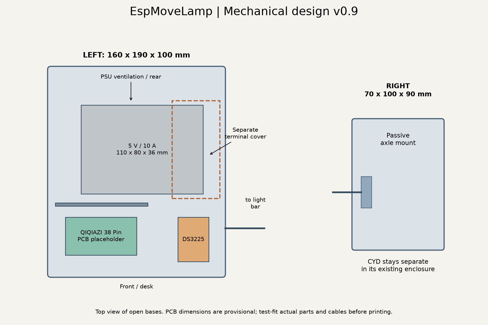
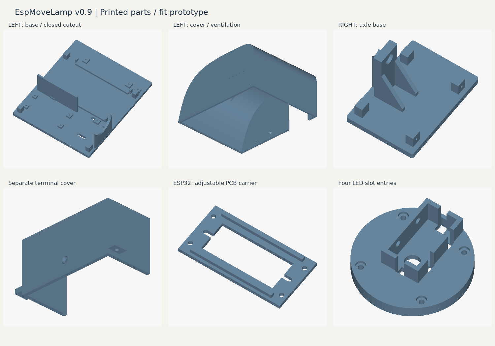

# Mechanical prototype v0.9 — assembly and fit notes

The lamp uses a **1 m 2040 aluminum extrusion**, four LED strips and two printed stands. Viewed from the desk, the **DS3225 servo, 5 V power supply and lamp ESP32** sit in the left stand; the right stand supports the passive axle. The rotation axis follows one of the extrusion's two core holes, intentionally offset from the center of the 2040 cross-section. The CYD touchscreen remains in a separate enclosure.

**Status:** Geometry-checked prototype, **not yet mechanically or electrically approved**. Fit the actual servo horn, aluminum extrusion, PCB, connectors, and power supply before final printing. CAD checks do not establish mechanical durability, electrical safety, or temperature performance.

## Printable parts

| STL in `hardware/stl/` | Qty. | Purpose |
| --- | ---: | --- |
| `left_electronics_base.stl` | 1 | Left base, servo mount, PSU supports, controller mounting |
| `left_electronics_cover.stl` | 1 | Removable ventilated left cover |
| `left_ds3225_servo_mount.stl` | 1 | Separate axially adjustable servo bracket |
| `right_axle_base.stl` | 1 | Compact passive right support |
| `right_cover.stl` | 1 | Right cover |
| `servo_rear_coupling_disc.stl` | 1 | Rear servo-side coupling disc |
| `axle_rear_coupling_disc.stl` | 1 | Rear passive axle disc |
| `profile_front_coupling_disc_2x.stl` | 2 | Front profile sleeves with LED cable entries |
| `psu_retaining_bracket_2x.stl` | 2 | PSU retention brackets |
| `esp32_pcb_carrier.stl` | 1 | Removable adjustable ESP32 PCB carrier |
| `esp32_pcb_retainer_2x.stl` | 2 | Adjustable PCB retainers |
| `psu_terminal_cover.stl` | 1 | Additional screw-fastened terminal cover |

All STL units are **millimeters**. Editable source: [`../cad/EspMoveLamp.scad`](../cad/EspMoveLamp.scad). STL filenames use English names; the `_2x` suffix indicates a part that is needed twice.

## Geometry and arrangement

- Left stand: **160 × 190 × 100 mm**; right stand: **70 × 100 × 90 mm**, including bases.
- Common axle center: **53 mm above the base**, **44 mm behind the front edge**.
- Round coupling discs: **72 mm diameter**; rear portion 13 mm, front portion 8 mm plus 12 mm sleeve.
- Planned 5 V / 10 A PSU envelope: **110 × 80 × 36 mm**. Supports are 4 mm above the 6 mm base; nominal vertical bracket clearance is 0.8 mm.
- The rear taper belongs to the outer housing. The PSU mounting region ends before it to maintain clearance.
- The base closes the previously open lower U-shaped cutout. The cover remains removable upwards; this passage is not a bearing.

The left and right stands have different widths. Do not scale the complete left cover to match the right stand; the shared axle height must remain unchanged.

## Lamp ESP32 board

Planned board: **ESP-WROOM-32 / 38-pin ESP32 DevKit with CP2102 and USB-C**. Its exact PCB outline and mounting holes have not been verified. The provisional PCB clearance envelope is **64 × 34 mm**. The adjustable carrier avoids assuming an undocumented mounting-hole pattern.

Check USB access, BOOT and EN buttons, header pins, underside solder joints, and actual board thickness before printing. The carrier fastens to four mounting points on the base. The antenna should face away from the metal power supply. The layout illustration shows a reserved volume, **not a dimensionally verified PCB model**.

## Servo coupling and load path

1. Insert the original metal servo horn into the open pocket of the rear servo-side disc.
2. Secure the outer horn hole with an M3 screw at **24 mm radius**. Verify the actual horn hole and nut clearance.
3. Attach the horn to the servo's original **25T spline** with the original central screw. The printed disc does not replace the spline.
4. Route the cables through the hidden channels; close the front disc with four M3 screws and nuts.
5. Insert the aluminum extrusion into the sleeve and secure it with two M4 screws and T-nuts on the unlit rear 40 mm face.

The additional circular access hole and external rectangular opening were removed from the front disc. A blind internal recess accommodates the M3 screw head. Assemble the horn connection before closing the discs. The central access through the profile is only available before the extrusion is inserted.

The right side uses a simple sliding axle: use a smooth shaft and avoid clamping it against the housing. **There is no dedicated radial bearing on the servo side.** The servo carries lateral load directly. Its nominal torque rating does not establish allowable side load or printed-part strength.

### Servo dimensional assumptions

The reference DS3225 drawing specifies approximately **40 × 20 mm** body dimensions, **40.4–40.5 mm** body height, **49.5 × 10 mm** flange hole spacing, **54.5 mm** overall flange width, and flange level **27.7 mm** above the body bottom. The roughly 10 mm shaft offset from the body center is derived from the drawing rather than separately dimensioned.

The assumed metal horn envelope is **35 × 15 × 6 mm** and must be checked against the supplied horn. The hub clearance diameter of 18 mm is also provisional. The adjustable servo bracket accommodates axial fit-up, but real shaft and hub protrusion must be measured.

## LED slots and cable routing

There are two strips at the front and one each at the top and bottom. Four cable entries follow the extrusion slots on the servo-side end. Provisional entry width is **6 mm**; confirm against the actual extrusion and silicone-coated LED strips.

The channels beneath the profile stop are 3 mm deep. A 4 mm stop separates the extrusion from the wiring cavity. The four entries merge into a concealed **8 × 6 mm** outlet through the rear disc into the left housing.

There is **no external cable loop around the passive right side** and no cable-tie eye on the base. Connectors may not fit through the passages: route individual wires before final assembly. Provide a flexible service loop inside the housing and test the entire motion range slowly for rubbing, pinching, or excessive bending.

The current firmware uses one serial LED data chain with parallel 5 V power injection. Refer to the root README for physical strip order and logical direction.

## Power supply, covers and heat

The PSU is retained by separate printed brackets rather than relying on unverified threaded mounting holes. Measure the actual unit, terminals, earth point, wiring clearances, and bracket fasteners before final printing. Do not obstruct ventilation.

The screwed terminal cover remains in place when the outer cover is removed. Its **6 mm pilot hole is not a finished mains cable entry**. Use a properly rated cable gland or equivalent strain relief, suitable wire routing, protective earth where required, and touch-safe mains termination. A printed cover alone is not proof of electrical compliance.

Avoid routing mains and low-voltage cables together without appropriate separation. Check enclosure and PSU temperatures under representative LED and servo loads. Choose printing material and wall thickness based on verified operating temperatures, not appearance alone.

## Fit-check and assembly checklist

1. Measure the actual servo, horn, PSU, controller board, connectors, and extrusion.
2. Print small fit samples for the servo pocket, profile sleeve, nut traps, and cable entries before the full covers.
3. Verify left and right axle heights and alignment on a flat surface.
4. Test servo movement **without the extrusion** and keep conservative firmware limits.
5. Assemble the two coupling discs, route wires, and mount the extrusion.
6. Slowly check the full intended sweep for collisions, cable tension, and unwanted play.
7. Confirm that both covers can be removed without dismantling the entire light.
8. Perform electrical safety checks and temperature tests before extended use.

The desired behavior is a **flat parked position** and a visible **fold-up movement** when activated. This is a mechanical design goal, not evidence of sensor-based homing: the firmware currently commands a configured servo target angle without physical position feedback.
